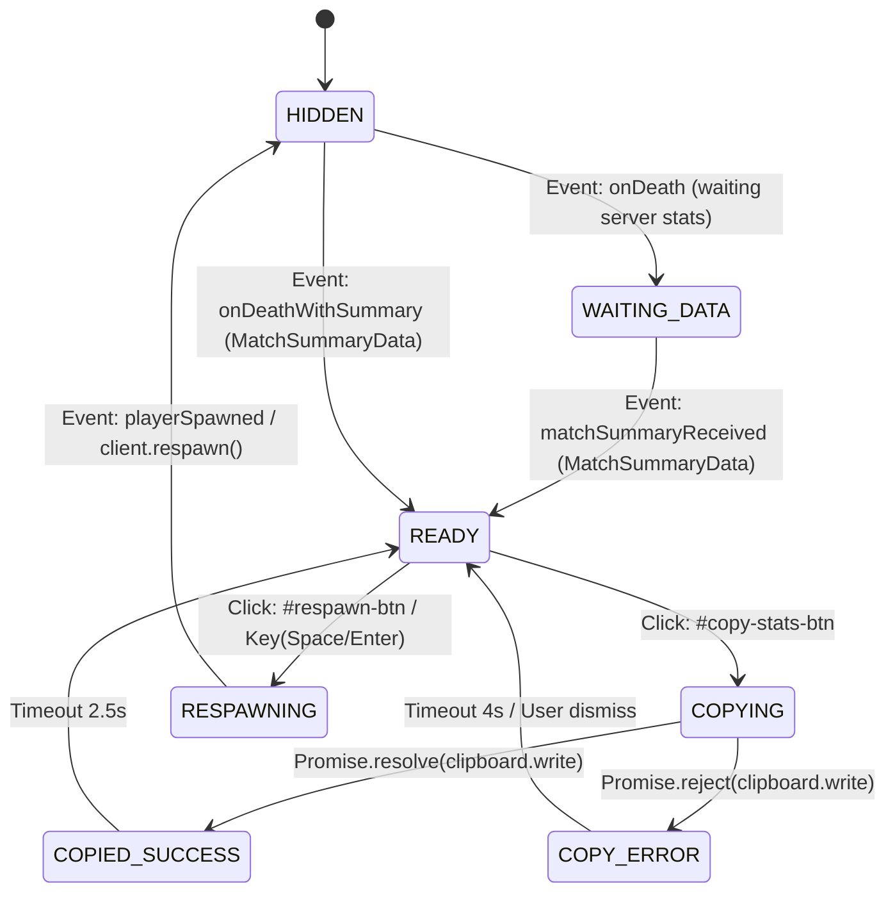
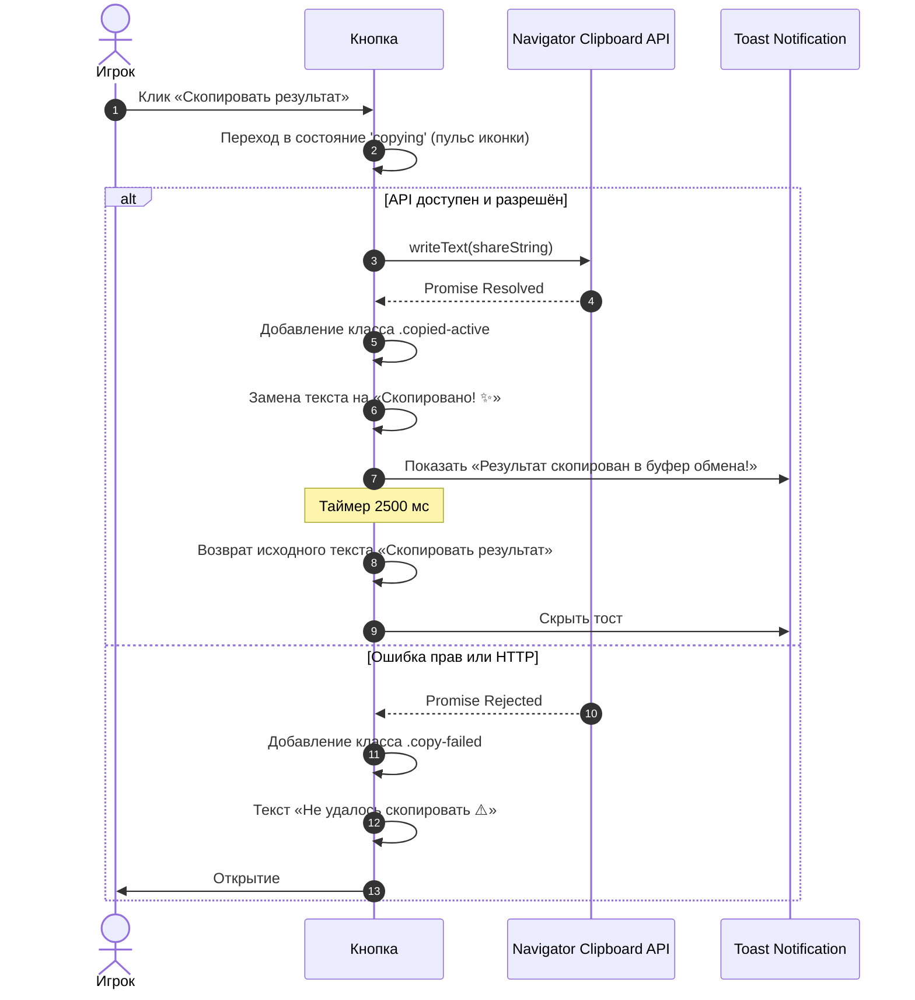

# Feature Specification: Game Over Modal (Match Summary UI)

**Feature Branch**: `001-ui-match-summary`  
**Created**: 2026-10-22  
**Status**: Final (Aligned with specs/003-contract.md)  
**Author**: Frontend UI Team  
**Contract Reference**: [specs/003-contract.md](../003-contract.md)  
**Target File**: `specs/001-ui-match-summary/spec.md`  
**Input**: User description: "/speckit.specify [КОМАНДА 1: FRONTEND UI] Разработай спецификацию только клиентского интерфейса для экрана окончания матча (Game Over Modal) в Lizard Arena."

---

## 1. Executive Summary & Design Overview

Данная спецификация описывает **исключительно клиентский интерфейс** (HTML5, CSS Glassmorphism, TypeScript DOM UI) модального экрана окончания матча (`Game Over Modal`) в игре **Lizard Arena**.

При гибели ящерицы игрок выбывает из основного цикла арены и видит премиальный интерфейс в стиле **Glassmorphism**, отображающий глубокую статистику забега, причину гибели и контекстные действия: шеринг результатов и мгновенный перезапуск игры.

### 1.1. Визуальный стиль (Glassmorphism & Game Aesthetic)
Интерфейс строго наследует дизайн-код проекта Lizard Arena (`src/styles.css`):
* **Фон подложки (Backdrop)**: `rgba(8, 12, 22, 0.82)` с размытием заднего плана `backdrop-filter: blur(12px)`. Игровой канвас остаётся видимым в расфокусе (виден кластер ягод на месте гибели).
* **Карточка модального окна (Glass Card)**: `background: rgba(22, 30, 48, 0.92)`, скругление `24px`, тонкая неоновая окантовка `1px solid rgba(255, 255, 255, 0.12)` и глубокая тень `0 24px 60px rgba(0, 0, 0, 0.65)`.
* **Акцентные цвета**:
  * Неоново-зелёный (`#2ECC71` / `#27AE60`) — респавн, рост, победные маркеры.
  * Кроваво-красный (`#E74C3C` / `#C0392B`) — экран гибели, урон, враг-победитель.
  * Золотистый (`#F1C40F` / `#F39C12`) — финальный счёт, звёзды, рекордные показатели.
  * Тёмно-синий сланец (`#121927` / `#1E293B`) — плашки метрик.
* **Типографика**: Заголовки — `Fredoka` (сочные, округлые, игровые), числа метрик и текстовые подписи — `Outfit` (высокая читаемость, плотный межбуквенный интервал).

---

## 2. User Scenarios & Testing *(mandatory)*

### User Story 1 - Наглядный разбор матча и 6 карточек метрик (Priority: P1)

Как погибший игрок, я хочу мгновенно увидеть итоговые результаты матча в виде наглядных карточек метрик, чтобы оценить свою эффективность, понять причину поражения и сравнить свой результат с предыдущими играми.

**Why this priority**: Это главный экран цикла окончания сессии (core loop closure). Без наглядной сводки игрок дезориентирован при гибели и теряет мотивацию играть дальше.

**Independent Test**: Может быть независимо протестирован вызовом `showGameOver(mockSummaryData)` в браузере: проверяется появление оверлея, корректный рендеринг имени убийцы и всех 6 числовых карточек с иконками.

**Acceptance Scenarios**:
1. **Given** игрок находился в живом состоянии на арене,  
   **When** сервер присылает событие гибели со сводкой матча,  
   **Then** внутриигровой HUD скрывается, поверх канваса плавно появляется модальное окно Game Over с заголовком, именем победителя/причиной гибели и сеткой из 6 карточек метрик.
2. **Given** отображается модальное окно с метриками,  
   **When** игрок просматривает карточки,  
   **Then** отображаются строго 6 метрик, форматированных клиентом из сырых числовых полей `MatchSummaryData` (согласно [specs/003-contract.md](../003-contract.md)):
   * **Финальный счёт** (`finalScore`): итоговые очки ящерицы до фатального удара с иконкой 🏆 (например, `480`).
   * **Время выживания** (`survivalTimeMs`): сырые миллисекунды форматируются в `MM:SS` (например, `222450` → `03:42`), а при длительности $\ge 60$ минут — в `HH:MM:SS`.
   * **Съеденные ягоды** (`berriesEaten`): целое неотрицательное число с иконкой 🍓 (например, `38`).
   * **Нанесённый урон** (`damageDealt`): суммарный урон соперникам с иконкой ⚔️ и суффиксом `" HP"` (например, `342 HP`).
   * **Поверженные враги** (`enemiesKilled`): количество ящериц, добитых игроком, с иконкой 💀 (например, `3`).
   * **Максимальный размер** (`maxScale`): пиковый множитель масштаба (float $\ge 1.00$) с иконкой 🦎 и суффиксом `'x'` (например, `2.15` → `2.15x`).

---

### User Story 2 - Мгновенный респавн «Играть снова» (Priority: P1)

Как проигравший игрок, я хочу в один клик нажать кнопку «Играть снова», чтобы вернуться в бой без необходимости повторно вводить никнейм и выбирать скин.

**Why this priority**: Высокая динамика io-игр требует мгновенного перезапуска (time-to-game < 1 сек), удерживая игрока в цикле «погиб → возродился».

**Independent Test**: Нажатие кнопки «Играть снова» вызывает метод `client.respawn(name)`, закрывает модальное окно, возвращает активный HUD и блокирует повторный клик до ответа сервера.

**Acceptance Scenarios**:
1. **Given** открыто модальное окно Game Over,  
   **When** пользователь нажимает кнопку «Играть снова» (`#respawn-btn`) или клавишу `Space` / `Enter`,  
   **Then** кнопка переходит в состояние ожидания (`loading`, с блокировкой от повторных кликов), отправляется запрос на респавн, модальное окно исчезает, и HUD возвращается.

---

### User Story 3 - Копирование красивого результата в буфер обмена (Priority: P2)

Как гордый своим рекордом игрок, я хочу нажать кнопку «Скопировать результат», чтобы получить в буфер обмена готовый текст с эмодзи для отправки друзьям в Telegram / Discord / X.

**Why this priority**: Виральный механизм распространения игры и социальное доказательство мастерства без необходимости скриншотить экран.

**Independent Test**: Нажатие кнопки копирует сгенерированный шаблон текста через `navigator.clipboard.writeText`, визуально меняет иконку и текст кнопки на «Скопировано! ✅» с анимацией пульсации на 2.5 секунды, после чего возвращает исходный вид кнопки.

**Acceptance Scenarios**:
1. **Given** открыто модальное окно со статистикой,  
   **When** игрок кликает по кнопке «Скопировать результат» (`#copy-stats-btn`),  
   **Then** в буфер обмена помещается текст вида:  
   `🦎 Lizard Arena | Счёт: 480 🏆 | Выживал: 03:42 ⏱️ | Ягод: 38 🍓 | Урон: 342 HP ⚔️ | Фраги: 3 💀 | Макс. размер: 2.19x 🦎 | Сыграй со мной!`  
   и кнопка на 2.5 секунды окрашивается в акцентный цвет с текстом `Скопировано! ✨`.
2. **Given** браузер заблокировал доступ к буферу обмена или API Clipboard недоступен (HTTP / iframe),  
   **When** игрок нажимает кнопку «Скопировать результат»,  
   **Then** UI не ломается, кнопка кратковременно подсвечивается предупреждающим цветом `Не удалось скопировать ⚠️`, и в карточке появляется вспомогательное текстовое поле для ручного копирования (`Ctrl+C`).

---

### User Story 4 - Состояния ожидания и устойчивость UI (Priority: P3)

Как пользователь с нестабильным сетевым соединением, я хочу видеть аккуратный скелетон/лоадер, если данные матча задерживаются от сервера, чтобы экран не мигал пустыми нулями.

**Why this priority**: Предотвращает визуальный глитч (Layout Shift / `0` во всех полях) при задержке передачи итогового пакета от бэкенда.

**Independent Test**: Вызов модального окна в состоянии `isLoading: true` показывает пульсирующие шиммер-заглушки (skeleton placeholders) на месте цифр до момента прихода полных данных.

**Acceptance Scenarios**:
1. **Given** сервер зарегистрировал гибель, но расширенный пакет статистики ещё летит по WebSocket,  
   **When** окно модалки активируется,  
   **Then** все плашки метрик отображают аккуратный градиентный шиммер-скелетон вместо нулей.  
2. **When** пакет данных получен,  
   **Then** шиммеры плавно заменяются анимированным счетчиком чисел (count-up animation).

---

### Edge Cases

* **EC-001: Нулевая или минимальная активность игрока**:
  * Игрок погиб в первые 3 секунды матча со счётом 100, 0 ягод, 0 урона, 0 фрагов.
  * *Поведение UI*: Все карточки отображают корректные нули без NaN и с валидным форматом таймера (`00:03`). Сообщение гибели корректно гласит: «Вы только вылупились и сразу стали чьей-то добычей! 🐣».
* **EC-002: Сверхбольшие числа (Extreme Values)**:
  * Игрок набрал `150 000` урона или `12 500` очков.
  * *Поведение UI*: Числа форматируются через локализованный разделитель тысяч (`Intl.NumberFormat('ru-RU')`, например: `15 420` вместо `15420`). Размер шрифта в карточке не ломает верстку и не выходит за границы плашки (`text-overflow: ellipsis` / динамический `clamp()`).
* **EC-003: Долгая сессия выживания (> 1 часа)**:
  * Время сессии превысило 60 минут.
  * *Поведение UI*: Формат времени автоматически расширяется с `MM:SS` до `HH:MM:SS` (например, `01:14:22`).
* **EC-004: Отказ прав Clipboard API**:
  * Пользователь в приватном режиме или без разрешения на запись в буфер.
  * *Поведение UI*: Обработка перехватывает `Promise.reject()`, не крашит приложение, показывает всплывающий тост или мини-инпут с выделенным текстом для стандартного `Ctrl+C`.
* **EC-005: Спам кликов по кнопкам**:
  * Пользователь многократно жмет «Играть снова» или «Скопировать результат».
  * *Поведение UI*: Кнопка респавна дизейблится после первого клика (`pointer-events: none`, атрибут `disabled`), предотвращая дубликаты сетевых пакетов. Кнопка копирования дебаунсится (таймер 2.5 сек сбрасывается и обновляется).
* **EC-006: Адаптивность к узким экранам**:
  * Разрешение экрана смартфона или узкого окна браузера (< 480px).
  * *Поведение UI*: Сетка карточек метрик трансформируется из двухколоночной `grid-template-columns: repeat(2, 1fr)` в гибкую адаптивную структуру, вертикальный скролл разрешен только внутри карточки при необходимости.

---

## 3. UI Requirements *(mandatory)*

### 3.1. Функциональные требования (Functional Requirements)

* **FR-001**: Модальное окно Game Over ДОЛЖНО монтироваться в DOM-дерево поверх игрового канваса с селектором `#gameover-modal` и фиксированным позиционированием `position: fixed`.
* **FR-002**: При активации модального окна игровой фокус и управление курсором арены ДОЛЖНЫ деактивироваться (`pointer-events: auto` у модалки, снятие флага `isPlaying`).
* **FR-003**: Шапка модального окна ДОЛЖНА содержать:
  1. Тематическую иконку статуса (например, 💀 или ⚰️).
  2. Заголовок окончания игры («Твою ящерицу победили!» или «Конец охоты!»).
  3. Плашку с причиной гибели и именем победителя: «Вас победил: **{killerName}**» (или нейтральное «Погиб в схватке», если имя отсутствует).
* **FR-004**: Блок статистики ДОЛЖЕН содержать ровно 6 карточек метрик, отображающих согласованные данные контракта `MatchSummaryData` ([specs/003-contract.md](../003-contract.md)):
  * **Карточка 1 (Финальный счёт)**: Итоговые очки на момент перед фатальным ударом (`finalScore`: целое число $\ge 0$, выделена акцентным цветом и крупным шрифтом).
  * **Карточка 2 (Время выживания)**: Общая длительность жизни ящерицы, вычисленная из сырых миллисекунд (`survivalTimeMs`) и форматированная в `MM:SS` (или `HH:MM:SS` при длительности $\ge 60$ минут).
  * **Карточка 3 (Съеденные ягоды)**: Суммарное число поглощенных ягод (`berriesEaten`: целое число $\ge 0$).
  * **Карточка 4 (Нанесённый урон)**: Суммарный урон, нанесенный всем соперникам за матч (`damageDealt`: целое число $\ge 0$, отображается с суффиксом `" HP"`).
  * **Карточка 5 (Поверженные враги)**: Количество врагов, чей последний урон был нанесен игроком (`enemiesKilled`: целое число $\ge 0$).
  * **Карточка 6 (Максимальный размер)**: Максимальный достигнутый масштаб ящерицы (`maxScale`: float $\ge 1.00$, клиент форматирует со знаком `'x'`, например `2.15x`).
* **FR-005**: Каждая карточка метрики ДОЛЖНА иметь:
  * Тематическую иконку / эмодзи.
  * Текстовую метку (label) верхним регистром в приглушенном оттенке (`#94a3b8`).
  * Числовое значение (value), выделенное шрифтом `Fredoka`.
* **FR-006**: Элементы управления ДОЛЖНЫ содержать 2 основные кнопки:
  * Кнопка **«Играть снова»** (`#respawn-btn`): основная кнопка (Primary CTA) с градиентом `#2ECC71 → #27AE60`.
  * Кнопка **«Скопировать результат»** (`#copy-stats-btn`): вторичная кнопка (Secondary Glass CTA) с иконкой 📋 и полупрозрачным фоном `rgba(255, 255, 255, 0.08)`.
* **FR-007**: При клике на кнопку «Скопировать результат» UI ДОЛЖЕН формировать строку шеринга:
  ```text
  🦎 Lizard Arena | Счёт: {finalScore} 🏆 | Выживал: {survivalTime} ⏱️ | Ягод: {berriesEaten} 🍓 | Урон: {damageDealt} HP ⚔️ | Фраги: {enemiesKilled} 💀 | Макс. размер: {maxScale}x 🦎 | Сыграй со мной: {gameUrl}
  ```
* **FR-008**: При успешной записи в буфер обмена кнопка ДОЛЖНА временно (на 2.5 секунды) изменить состояние:
  * Текст: `Скопировано в буфер! ✨`
  * Иконка: `✅`
  * Стиль границы: зеленое неоновое свечение `box-shadow: 0 0 16px rgba(46, 204, 113, 0.6)`.
* **FR-009**: При ошибке записи в буфер обмена UI ДОЛЖЕН показать понятное уведомление об ошибке и отобразить временное поле ввода с выделенным текстом для ручного нажатия `Ctrl+C`.
* **FR-010**: Кнопка «Играть снова» ДОЛЖНА поддерживать вызов по горячим клавишам `Enter` и `Space` при условии, что фокус не находится в текстовом поле.
* **FR-011**: Во время состояния респавна кнопка ДОЛЖНА блокироваться (`disabled`), меняя текст на `Возрождение... ⏳`.
* **FR-012**: Модальное окно ДОЛЖНО поддерживать состояние загрузки (`Loading / Skeleton`), если модалка показана до получения полного JSON-пакета от сервера.
* **FR-013**: Интерфейс НЕ ДОЛЖЕН содержать внешних картинок, сторонних шрифтовых файлов `.woff` со сторонних хостингов (за исключением уже подключенного в `index.html` Google Fonts) или внешних медиа-ресурсов.

---

### 3.2. Архитектура DOM-структуры (HTML Layout)

```html
<!-- Game Over Modal Specification -->
<div id="gameover-modal" class="modal-backdrop hidden" role="dialog" aria-modal="true" aria-labelledby="gameover-title">
  <div class="modal-card gameover-card">
    
    <!-- Header: Status & Killer Banner -->
    <div class="gameover-header">
      <div class="gameover-badge" aria-hidden="true">💀</div>
      <h2 id="gameover-title" class="gameover-title">Твою ящерицу победили!</h2>
      <div class="killer-banner" id="killer-banner">
        <span class="killer-label">Победитель:</span>
        <span class="killer-name" id="killer-name-display">Хищный Варан</span>
      </div>
    </div>

    <!-- Metrics Grid: 6 Distinct Stat Cards -->
    <div class="stats-grid" id="stats-grid" aria-label="Итоговая статистика матча">
      
      <!-- Card 1: Final Score (Primary Accent) -->
      <div class="stat-card stat-card-featured" id="card-final-score">
        <div class="stat-card-header">
          <span class="stat-icon">🏆</span>
          <span class="stat-label">Финальный счёт</span>
        </div>
        <div class="stat-value" id="val-final-score">0</div>
      </div>

      <!-- Card 2: Survival Time -->
      <div class="stat-card" id="card-survival-time">
        <div class="stat-card-header">
          <span class="stat-icon">⏱️</span>
          <span class="stat-label">Время жизни</span>
        </div>
        <div class="stat-value" id="val-survival-time">00:00</div>
      </div>

      <!-- Card 3: Berries Eaten -->
      <div class="stat-card" id="card-berries">
        <div class="stat-card-header">
          <span class="stat-icon">🍓</span>
          <span class="stat-label">Ягод съедено</span>
        </div>
        <div class="stat-value" id="val-berries-eaten">0</div>
      </div>

      <!-- Card 4: Damage Dealt -->
      <div class="stat-card" id="card-damage">
        <div class="stat-card-header">
          <span class="stat-icon">⚔️</span>
          <span class="stat-label">Урон врагам</span>
        </div>
        <div class="stat-value" id="val-damage-dealt">0</div>
      </div>

      <!-- Card 5: Enemies Defeated (Kills) -->
      <div class="stat-card" id="card-kills">
        <div class="stat-card-header">
          <span class="stat-icon">🎯</span>
          <span class="stat-label">Врагов добито</span>
        </div>
        <div class="stat-value" id="val-enemies-killed">0</div>
      </div>

      <!-- Card 6: Peak Lizard Scale -->
      <div class="stat-card" id="card-max-scale">
        <div class="stat-card-header">
          <span class="stat-icon">🦎</span>
          <span class="stat-label">Макс. размер</span>
        </div>
        <div class="stat-value" id="val-max-scale">1.00x</div>
      </div>

    </div>

    <!-- Fallback Manual Copy Container (Shown only on clipboard error) -->
    <div id="clipboard-fallback" class="clipboard-fallback hidden">
      <p class="fallback-tip">Скопируйте результат вручную (Ctrl + C):</p>
      <input type="text" id="clipboard-fallback-input" readonly />
    </div>

    <!-- Action Buttons -->
    <div class="modal-actions">
      <button id="respawn-btn" class="btn-primary btn-respawn">
        <span class="btn-icon">🔄</span>
        <span class="btn-text">Играть снова</span>
      </button>

      <button id="copy-stats-btn" class="btn-secondary btn-copy">
        <span class="btn-icon">📋</span>
        <span class="btn-text">Скопировать результат</span>
      </button>
    </div>

    <!-- Toast Notification for Micro-Interactions -->
    <div id="gameover-toast" class="gameover-toast hidden" role="status" aria-live="polite"></div>

  </div>
</div>
```

---

### 3.3. Визуальная спецификация стилей (CSS Design Tokens & Classes)

```css
/* Glassmorphism Game Over Modal Specific Styles */

.gameover-card {
  max-width: 520px;
  width: 92%;
  padding: 32px 28px;
  background: rgba(18, 25, 42, 0.94);
  border: 1px solid rgba(255, 255, 255, 0.12);
  border-radius: 24px;
  box-shadow: 
    0 24px 60px rgba(0, 0, 0, 0.7),
    0 0 40px rgba(231, 76, 60, 0.12),
    inset 0 1px 1px rgba(255, 255, 255, 0.15);
  animation: modalPopIn 0.35s cubic-bezier(0.175, 0.885, 0.32, 1.275);
}

.gameover-header {
  margin-bottom: 24px;
}

.gameover-badge {
  font-size: 3.2rem;
  line-height: 1;
  margin-bottom: 8px;
  filter: drop-shadow(0 4px 12px rgba(231, 76, 60, 0.4));
  animation: pulseBadge 2s infinite ease-in-out;
}

.gameover-title {
  font-family: 'Fredoka', cursive;
  font-size: 2rem;
  font-weight: 700;
  letter-spacing: 0.5px;
  color: #fff;
  margin-bottom: 10px;
  text-shadow: 0 2px 8px rgba(0, 0, 0, 0.5);
}

.killer-banner {
  display: inline-flex;
  align-items: center;
  gap: 6px;
  background: rgba(231, 76, 60, 0.15);
  border: 1px solid rgba(231, 76, 60, 0.3);
  padding: 6px 14px;
  border-radius: 20px;
  font-size: 0.9rem;
  color: #fca5a5;
}

.killer-name {
  font-weight: 700;
  color: #ffffff;
}

/* 6 Metrics Grid */
.stats-grid {
  display: grid;
  grid-template-columns: repeat(2, 1fr);
  gap: 12px;
  margin-bottom: 26px;
}

.stat-card {
  background: rgba(14, 20, 34, 0.75);
  border: 1px solid rgba(255, 255, 255, 0.08);
  border-radius: 14px;
  padding: 12px 14px;
  text-align: left;
  transition: transform 0.2s, border-color 0.2s, box-shadow 0.2s;
}

.stat-card:hover {
  transform: translateY(-2px);
  border-color: rgba(255, 255, 255, 0.18);
  box-shadow: 0 6px 16px rgba(0, 0, 0, 0.3);
}

/* Featured Card: Final Score spans full width or highlighted */
.stat-card-featured {
  grid-column: span 2;
  background: linear-gradient(135deg, rgba(241, 196, 15, 0.12), rgba(230, 126, 34, 0.08));
  border-color: rgba(241, 196, 15, 0.3);
}

.stat-card-featured .stat-value {
  color: #f1c40f;
  font-size: 2.2rem;
}

.stat-card-header {
  display: flex;
  align-items: center;
  gap: 6px;
  margin-bottom: 4px;
}

.stat-icon {
  font-size: 1.1rem;
}

.stat-label {
  font-size: 0.76rem;
  text-transform: uppercase;
  letter-spacing: 0.6px;
  color: #94a3b8;
  font-weight: 600;
}

.stat-value {
  font-family: 'Fredoka', cursive;
  font-size: 1.5rem;
  font-weight: 700;
  color: #f8fafc;
}

/* Modal Buttons */
.modal-actions {
  display: flex;
  flex-direction: column;
  gap: 10px;
}

.btn-respawn {
  display: flex;
  align-items: center;
  justify-content: center;
  gap: 8px;
  padding: 14px;
  font-size: 1.2rem;
  box-shadow: 0 6px 20px rgba(46, 204, 113, 0.4);
}

.btn-secondary {
  display: flex;
  align-items: center;
  justify-content: center;
  gap: 8px;
  width: 100%;
  padding: 12px 18px;
  font-family: 'Outfit', sans-serif;
  font-size: 1rem;
  font-weight: 600;
  color: #cbd5e1;
  background: rgba(255, 255, 255, 0.06);
  border: 1px solid rgba(255, 255, 255, 0.14);
  border-radius: 12px;
  cursor: pointer;
  transition: all 0.2s ease;
}

.btn-secondary:hover {
  background: rgba(255, 255, 255, 0.12);
  color: #ffffff;
  border-color: rgba(255, 255, 255, 0.25);
  transform: translateY(-1px);
}

.btn-secondary.copied-active {
  background: rgba(46, 204, 113, 0.2);
  border-color: #2ecc71;
  color: #2ecc71;
  box-shadow: 0 0 16px rgba(46, 204, 113, 0.4);
}

.btn-secondary.copy-failed {
  background: rgba(231, 76, 60, 0.2);
  border-color: #e74c3c;
  color: #fca5a5;
}

/* Fallback Input */
.clipboard-fallback {
  margin-bottom: 14px;
  text-align: left;
}

.fallback-tip {
  font-size: 0.8rem;
  color: #f87171;
  margin-bottom: 4px;
}

.clipboard-fallback input {
  width: 100%;
  padding: 8px 12px;
  background: #0f172a;
  border: 1px solid #475569;
  border-radius: 8px;
  color: #f1f5f9;
  font-size: 0.85rem;
}

/* Animations */
@keyframes modalPopIn {
  0% { transform: scale(0.9) translateY(20px); opacity: 0; }
  100% { transform: scale(1) translateY(0); opacity: 1; }
}

@keyframes pulseBadge {
  0%, 100% { transform: scale(1); }
  50% { transform: scale(1.08); }
}
```

---

## 4. State Machine & UI Lifecycle

Клиентский контроллер экрана окончания игры управляется строгим конечным автоматом состояний (Finite State Machine).



### 4.1. Детальное описание состояний UI

| Состояние | Визуальное проявление в DOM | Доступные действия пользователя |
| :--- | :--- | :--- |
| **`HIDDEN`** | Контейнер `#gameover-modal` имеет класс `.hidden`. Активен `HUD`. | Управление живой ящерицей в матче. |
| **`WAITING_DATA`** | Модалка показана, но в ячейках метрик пульсируют шиммеры `.skeleton-shimmer`. Кнопка респавна активна, кнопка копирования заблокирована. | Нажатие «Играть снова» (пропуск ожидания) или ожидание данных. |
| **`READY`** | Все 6 карточек заполнены форматированными числами с анимацией плавного появления (`fadeIn`). | Клик по кнопке «Скопировать результат», клик «Играть снова», нажатие `Space`/`Enter`. |
| **`COPIED_SUCCESS`** | Кнопка копирования подсвечена неоновым зеленым (`#2ECC71`), текст: «Скопировано! ✨», кратковременный тост внизу экрана. | Все действия доступны, таймер авто-возврата через 2.5 сек. |
| **`COPY_ERROR`** | Кнопка копирования подсвечена красным, раскрывается блок `#clipboard-fallback` с предвыделенным текстом для `Ctrl+C`. | Ручное копирование текста или закрытие/респавн. |
| **`RESPAWNING`** | Кнопка «Играть снова» переходит в `disabled`, отображается спиннер `Возрождение... ⏳`. Модалка плавно угасает. | Блокировка от повторных нажатий до получения первого снапшота нового матча. |

---

## 5. Согласованный Сетевой Контракт (Backend-to-Frontend JSON)

> **Авторитетный контракт:** [specs/003-contract.md](../003-contract.md)  
> Интерфейс объявляется в `shared/types.ts` и используется как сервером, так и клиентом.

Для полной отрисовки всех заявленных карточек метрик UI принимает от сервера объект `MatchSummaryData`. Все числовые поля приходят в виде **сырых чисел** (raw numbers) без строковых суффиксов.

### 5.1. Формат TypeScript-интерфейса `MatchSummaryData`

```typescript
export interface MatchSummaryData {
  type: 'match_summary';  // Канонический тип события гибели
  playerId: string;       // ID погибшего игрока ("player_1")
  killerName: string;     // Имя ящерицы-победителя или "Дикая природа"
  killerId?: string;      // ID победителя (если убит другой ящерицей)
  
  // 6 ключевых числовых метрик (сырые неотрицательные числа):
  finalScore: number;     // Счёт перед фатальным ударом (preDeathScore, целое >= 0)
  survivalTimeMs: number; // Время жизни в миллисекундах (целое >= 0)
  berriesEaten: number;   // Количество съеденных ягод (целое >= 0)
  damageDealt: number;    // Суммарный нанесенный урон соперникам (целое >= 0)
  enemiesKilled: number;  // Количество ликвидированных противников (целое >= 0)
  maxScale: number;       // Максимальный масштаб ящерицы (float, 2 знака, >= 1.00)

  // Метаданные матча:
  peakScore: number;      // Максимальный исторический счёт за сессию (>= 100)
  matchRank: number;      // Итоговое место в текущем лидерборде (>= 1)
  timestamp: number;      // Серверный Unix-timestamp в миллисекундах
}
```

### 5.2. Пример эталонного JSON-ответа от сервера

```json
{
  "type": "match_summary",
  "playerId": "player_1",
  "killerName": "Дракон-Император",
  "killerId": "bot-9842",
  "finalScore": 480,
  "survivalTimeMs": 222450,
  "berriesEaten": 38,
  "damageDealt": 342,
  "enemiesKilled": 3,
  "maxScale": 2.19,
  "peakScore": 510,
  "matchRank": 2,
  "timestamp": 1729612345678
}
```

### 5.3. Клиентский маппинг и устойчивость к неполным данным (Graceful Fallback)
Если клиент взаимодействует с сервером, вернувшим легаси-сообщение `{ type: 'died', killerName: 'Варан', finalScore: 150 }`, клиентский фронтенд автоматически конструирует `MatchSummaryData` с локально накопленными данными из `GameClient`:
* `finalScore`: `msg.finalScore ?? Math.max(0, Math.round(client.currentScore))`.
* `survivalTimeMs`: локальный таймер `Math.max(0, Date.now() - client.matchStartTime)`.
* `berriesEaten`: локальный счётчик `client.berriesEatenCount`.
* `damageDealt`: локальный накопитель урона `client.damageDealtCount` из обработчика `DamageEvent`.
* `enemiesKilled`: локальный счётчик `client.enemiesKilledCount || 0`.
* `maxScale`: высчитывается по формуле `Math.sqrt(Math.max(10, client.peakScore) / 100)`.
* `peakScore`: `Math.max(100, client.peakScore)`.
* `matchRank`: вычисляется по последнему `currentSnapshot.leaderboard`.
* `timestamp`: `Date.now()`.

---

## 6. Микро-взаимодействия и текст для шеринга

### 6.1. Формат строки шеринга для буфера обмена
Шаблон строки формируется функцией `formatShareMessage(summary)`:
```text
🦎 Lizard Arena
🏆 Счёт: 480
⏱️ Время выживания: 03:42
🍓 Съедено ягод: 38
⚔️ Нанесено урона: 342 HP
💀 Повержено врагов: 3
📏 Макс. размер: 2.19x

Сможешь вырастить ящерицу больше моей? Заходи в игру! 🎮
```

### 6.2. Пошаговый сценарий клика по кнопке копирования


---

## 7. Success Criteria *(mandatory)*

### Measurable Outcomes (Измеримые критерии качества UI)

* **SC-001 (Скорость рендера)**: Время от получения события гибели ящерицы до полной визуализации модального окна и всех 6 карточек метрик составляет **не более 80 мс** (отсутствие видимых просадок FPS и фризов канваса).
* **SC-002 (Эргономика респавна)**: Игрок может перезапустить матч за **1 действие** (нажатие `Space`, `Enter` или клик по кнопке), время повторного входа в игру сокращено до минимума.
* **SC-003 (Надёжность буфера обмена)**: В 100% случаев вызова кнопки шеринга пользователь получает обратную связь (либо успешную индикацию «Скопировано!», либо доступное fallback-поле при ошибке прав).
* **SC-004 (Адаптивность верстки)**: Верстка карточки модального окна корректно отображается без горизонтального скролла на экранах шириной от 360px до 4K мониторов.
* **SC-005 (Чистота кода)**: Отсутствие использования `any` в TypeScript-модулях UI модального окна; успешное прохождение единого раннера `sh scripts/check.sh`.

---

## 8. Assumptions & Scope Boundaries

### 8.1. Допущения (Assumptions)
1. Клиент уже располагает подключенными шрифтами `Fredoka` и `Outfit` в `index.html`.
2. Браузер пользователя поддерживает современные CSS-свойства `backdrop-filter: blur(...)` и CSS Grid (стандарт современных Chrome, Firefox, Safari).
3. Звуковой движок `SoundEffects.ts` уже воспроизводит звук гибели `sound.playDeath()`, дополнительное наложение звуков в модалке опционально (можно добавить лёгкий щелчок на кнопку).

### 8.2. Границы ответственности (Out of Scope)
* **Серверная реализация подсчёта фрагов и урона**: Логика накопления на стороне бэкенда лежит в зоне ответственности backend-команды. UI ориентируется на согласованный контракт `MatchSummaryData` ([specs/003-contract.md](../003-contract.md)) и готов к локальному fallback-расчёту на клиенте при старых версиях сервера.
* **Постоянная база данных профиля**: Сохранение истории матчей в базу данных (PostgreSQL / Redis) или личный кабинет не входит в объем данной фичи (статистика отображается за текущий матч).
* **Сетевой рендеринг канваса**: Сам процесс рендеринга ящериц и мира не затрагивается, модалка накладывается как стандартный HTML/CSS слой поверх `#game-canvas`.
