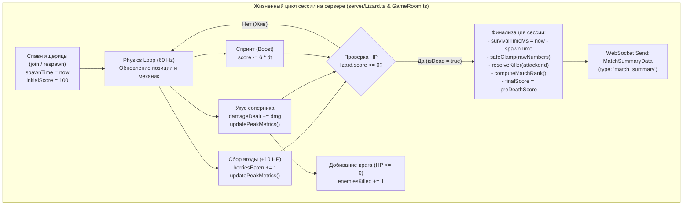

# Feature Specification: Server Session Stats & Match Summary Logic

**Feature Branch**: `002-logic-match-summary`  
**Created**: 2026-10-22  
**Status**: Final (Aligned with specs/003-contract.md)  
**Author**: Backend Engineering Team (Команда 2: Backend Logic)  
**Contract Reference**: [specs/003-contract.md](../003-contract.md)  
**Target File**: `specs/002-logic-match-summary/spec.md`  
**Input**: User description: `[КОМАНДА 2: BACKEND LOGIC] Разработай спецификацию серверной модели данных и логики арены для сбора статистики сессии ящерицы в Lizard Arena.`

---

## 1. Executive Summary & Backend Architecture Overview

Данный документ представляет собой **строгую спецификацию серверной модели данных, игровой логики и сетевого протокола** для сбора, агрегации и валидации статистики жизненного цикла ящерицы в игре **Lizard Arena**.

В соответствии с принципами разделения ответственности (Separation of Concerns):
* **Сервер является абсолютным авторитетом (Server Authority)** в отношении всех физических и боевых показателей: времени жизни, нанесённого урона, съеденных ягод, фрагов и пиковых значений.
* **Сервер не занимается вёрсткой, UI и форматированием данных**: сервер оперирует и передаёт **исключительно сырые примитивные числа** (raw numbers) и строки идентификаторов (никаких строковых суффиксов вроде `"03:42"`, `"342 HP"`, `"2.15x"`, `"100 очков"`).
* **Своевременная фиксация окончания сессии**: при наступлении условия $\text{HP} \le 0$ сервер фиксирует финализированное состояние статистики сессии, определяет источник гибели и отправляет игроку структурированный DTO через WebSocket-соединение.



---

## 2. User Scenarios & Testing *(mandatory)*

### User Story 1 - Атомарный сбор и отправка метрик при гибели (Priority: P1)

Как подключенный к арене игрок, когда здоровье моей ящерицы падает до 0 в результате укуса соперника или столкновения, я хочу получить от сервера полный и достоверный пакет со статистикой моей сессии, содержащий ровно 6 ключевых числовых показателей забега.

**Why this priority**: Является основой цикла завершения матча (Match Summary). Без этих сырых данных клиентский экран Game Over не может корректно отобразить карточки результатов.

**Independent Test**:
1. Игрок входит в игру со стартовым счётом 100 HP.
2. Игрок съедает 3 ягоды (+30 HP), наносит 2 укуса боту суммарно на 52 урона, добивает одного бота и затем погибает от укуса более крупного противника через 15.4 секунды.
3. Проверяется входящее WebSocket-сообщение:
   * `survivalTimeMs` $\approx 15400 \pm 100$
   * `berriesEaten` $= 3$
   * `damageDealt` $= 52$
   * `enemiesKilled` $= 1$
   * `maxScale` $\approx 1.14$
   * `finalScore` $\ge 0$ (целое число)
   * `killerName` соответствует имени атакующего бота.

**Acceptance Scenarios**:
1. **Given** ящерица игрока активна в мире со счётом 100,  
   **When** соперник наносит укус, превышающий остаток здоровья жертвы,  
   **Then** сервер переводит `victim.isDead = true`, прекращает обработку ввода от этой ящерицы и немедленно отправляет сокет-пакет с типом `match_summary` (или расширенный `died`) с корректно вычисленными метриками.
2. **Given** ящерица нанесла урон нескольким противникам за жизнь,  
   **When** наступает гибель,  
   **Then** поле `damageDealt` содержит точную сумму всех фактически нанесённых повреждений, а не только последнего удара.

---

### User Story 2 - Учёт фрагов и корректное определение убийцы (Priority: P1)

Как атакующий игрок, когда мой укус снижает здоровье соперника до $\le 0$, я хочу, чтобы сервер засчитал мне +1 к поверженным врагам (`enemiesKilled`), а жертве в поле `killerName` и `killerId` указал мои данные.

**Why this priority**: Начисление фрагов и указание победителя — ключевой элемент соревновательного баланса и справедливости в PvP.

**Independent Test**:
1. Спавнятся две ящерицы: Атакующий A (ID: `p1`, Имя: `Rex`) и Жертва B (ID: `p2`, Имя: `Gila`).
2. У Жертвы B остаётся 15 HP.
3. Атакующий A наносит укус силой 25 HP.
4. Жертва B погибает.
5. Проверяется:
   * У Жертвы B в MatchSummaryData: `killerName === 'Rex'`, `killerId === 'p1'`.
   * В объекте Атакующего A: `enemiesKilled === 1`.

**Acceptance Scenarios**:
1. **Given** ящерица A кусает ящерицу B с остатком HP 20 (урон 25),  
   **When** фиксируется гибель ящерицы B,  
   **Then** сервер инкрементирует `A.sessionStats.enemiesKilled++`, а в `B.sessionStats.killer` записывает имя и ID ящерицы A.
2. **Given** ящерица погибает без прямого удара (например, гипотетический урон окружения или крайний случай),  
   **When** `killerName` не определён,  
   **Then** сервер подставляет безопасный fallback: `killerName = 'Дикая природа'` (или `'Красная зона'`), а `killerId = undefined`.

---

### User Story 3 - Идемпотентность и защита от дублирования смерти (Priority: P1)

Как серверный движок, при одновременных событиях (например, два бота укусили игрока на одном физическом тике или взаимный head-to-head укус), сервер должен гарантировать, что финализация сессии и отправка пакета происходят **ровно один раз**.

**Why this priority**: Предотвращает дублирующие сокет-события, спам пакетами, гонки состояний и падение WebSocket-сессии.

**Independent Test**:
1. На одном тике физики к ящерице игрока одновременно применяются два смертельных удара.
2. Проверяется, что сокет получает ровно **одно** сообщение о гибели, и сервер не генерирует повторные события в последующих тиках.

**Acceptance Scenarios**:
1. **Given** ящерица уже имеет флаг `isDead === true` или `isFinalized === true`,  
   **When** в том же тике или в следующем тике происходит повторная проверка или коллизия,  
   **Then** сервер игнорирует урон, не пересчитывает метрики и не отправляет повторный DTO.

---

### User Story 4 - Респавн и изоляция сессий (Priority: P2)

Как игрок, отправляющий сообщение `{ type: 'respawn', name: 'Rex' }`, я хочу начать чистую игровую сессию с обнулёнными метриками, чтобы статистика прошлой жизни не влияла на новый забег.

**Why this priority**: Каждая жизнь в io-играх — независимый изолированный инстанс. Смешивание метрик разрушает соревновательную целостность.

**Independent Test**:
1. Игрок завершил сессию 1 (набрал 300 очков, 10 ягод).
2. Клиент отправляет `respawn`.
3. Сразу после спавна проверяются внутренние счетчики игрока:
   * `berriesEaten === 0`
   * `damageDealt === 0`
   * `enemiesKilled === 0`
   * `peakScore === 100`
   * `maxScale === 1.00`
   * `spawnTime === Date.now()`

**Acceptance Scenarios**:
1. **Given** сессия игрока завершена,  
   **When** игрок вызывает `respawnPlayer(sessionId, name)`,  
   **Then** создаётся новый объект `Lizard` или вызывается `resetSession()`, гарантирующий нулевые значения всех счётчиков и новый таймстемп спавна.

---

### User Story 5 - Корректная обработка дисконнекта (Priority: P2)

Как сервер, когда игрок внезапно закрывает вкладку или обрывает WebSocket-соединение, система должна корректно освободить ресурсы в `GameRoom`, не вызывая исключений и не оставляя «висячих» ссылок.

**Why this priority**: Предотвращение утечек памяти Node.js и падений процесса при попытке записи в закрытый сокет.

**Independent Test**:
1. Активный игрок внезапно закрывает сокет (`ws.close()`).
2. Сервер вызывает `removePlayer(id)`.
3. Проверяется отсутствие неперехваченных ошибок (`unhandledRejection`, `EPIPE`, `WebSocket is not open`), удаление ящерицы из `Map`, а также корректное продолжение физического цикла для оставшихся игроков и ботов.

---

### Edge Cases (Граничные случаи и аномалии)

1. **Смерть на 0-м тике ($t \le 16\text{ ms}$):**
   * *Условие*: Ящерица спавнится прямо в пасти гигантского варана и погибает в первом же физическом тике.
   * *Поведение сервера*: `survivalTimeMs = Math.max(0, deathTime - spawnTime)` (может быть 0..16 мс). Значения `berriesEaten = 0`, `damageDealt = 0`, `enemiesKilled = 0`, `peakScore = 100`, `maxScale = 1.00`. Исключено деление на ноль в любых внутренних формулах.
2. **Взаимная смерть (Head-to-Head Double KO):**
   * *Условие*: Две ящерицы сталкиваются головами на встречных курсах, нанося друг другу смертельный урон на одном тике.
   * *Поведение сервера*: Обе ящерицы помечаются погибшими на текущем тике. Каждая получает `enemiesKilled++`, каждая получает DTO со статусом гибели и указанием противоположной ящерицы в качестве убийцы. Кластеры ягод спавнятся на месте обеих ящериц.
3. **Смерть от истощения при ускорении (Sprint Drain):**
   * *Условие*: В соответствии с правилами игры ускорение разрешено только при $\text{HP} > 30$. Однако если ящерица ускоряется при 31 HP и одновременно получает скользящий урон.
   * *Поведение сервера*: `score` никогда не опускается ниже 0. Если урон опустил здоровье до $\le 0$, фиксируется гибель от атакующего.
4. **Попытка отправки в закрытый сокет (`ws.readyState !== WebSocket.OPEN`):**
   * *Условие*: Игрок разорвал соединение в тот же миллисекундный интервал, когда его ящерица была добита.
   * *Поведение сервера*: Перед вызовом `ws.send()` сервер выполняет строгую проверку `ws && ws.readyState === WebSocket.OPEN`. При закрытом сокете отправка пропускается, сессия тихо удаляется.
5. **Предотвращение отрицательных чисел и NaN:**
   * *Условие*: Ошибки вычислений с плавающей точкой в `dt`, непредвиденные входные значения.
   * *Поведение сервера*: Все счётчики проходят обязательную санитизацию: `Math.max(0, Math.round(value))`. Если значение `NaN` или `undefined`, подставляется `0`.

---

## 3. Требования (Requirements)

### 3.1. Функциональные требования (Functional Requirements)

- **FR-001 (Спавн и фиксация времени)**: При инстанцировании ящерицы (`join` или `respawn`) сервер MUST зафиксировать метку времени старта сессии: `spawnTime = Date.now()`.
- **FR-002 (Счётчик съеденных ягод)**: В цикле `GameRoom.update` при успешном изъятии ягоды из мира (`berryManager.remove(berry.id) === true`) сервер MUST атомарно инкрементировать счётчик съеденных ягод: `berriesEaten += 1`.
- **FR-003 (Суммарный нанесённый урон)**: В фазе боя (`GameRoom.update`) при успешной регистрации укуса сервер MUST добавлять нанесённый урон в накопитель атакующей ящерицы: `attacker.sessionStats.damageDealt += dmg`.
- **FR-004 (Счётчик поверженных врагов / фрагов)**: Если укус атакующего привёл к гибели жертвы (`victim.score <= 0` и `victim.isDead === true`), сервер MUST инкрементировать фраги атакующего: `attacker.sessionStats.enemiesKilled += 1`.
- **FR-005 (Фиксация убийцы)**: При смертельном укусе сервер MUST зафиксировать в сессии жертвы идентификатор и имя убийцы: `victim.sessionStats.killerId = attacker.id` и `victim.sessionStats.killerName = attacker.name`.
- **FR-006 (Пиковый счёт)**: На протяжении всей сессии сервер MUST отслеживать исторический максимум очков: `peakScore = Math.max(peakScore, Math.round(score))`. Стартовое значение — стартовый счёт ящерицы (100).
- **FR-007 (Пиковый масштаб)**: Сервер MUST отслеживать максимальный достигнутый коэффициент масштаба тела ящерицы: `maxScale = Math.max(maxScale, getScaleFromScore(score))`.
- **FR-008 (Финальный счёт)**: Финальный счёт ящерицы при гибели MUST быть неотрицательным целым числом ($\ge 0$). Сервер фиксирует предсмертное значение очков перед фатальным ударом (`preDeathScore`) в поле `finalScore` (согласно [specs/003-contract.md](../003-contract.md)), предотвращая обнуление показателя до 0.
- **FR-009 (Вычисление ранга)**: При гибели игрока сервер SHOULD определить его позицию в текущем лидерборде живых ящериц арены на момент смерти (`matchRank`: целое число от 1 до $N$).
- **FR-010 (Запрет серверного форматирования)**: Сервер MUST NOT форматировать числовые данные в строки (запрещены шаблоны вроде `"01:23"`, `"140 HP"`, `"1.85x"`). Все метрики передаются только как примитивные типы `number`.
- **FR-011 (Валидация неотрицательности)**: Все числовые метрики `MatchSummaryData` MUST быть строго валидированы перед сериализацией: $\ge 0$, без `NaN`, без `Infinity`.
- **FR-012 (Сетевой протокол MatchSummaryData)**: При наступлении $\text{HP} \le 0$ сервер MUST отправить игроку WebSocket-сообщение с полезной нагрузкой `MatchSummaryData` (с каноническим `type: 'match_summary'`).
- **FR-013 (Обратная совместимость)**: Сетевой пакет гибели MUST поддерживать обратную совместимость с существующим обработчиком `msg.type === 'died'` (клиенты, ожидающие `killerName` и `finalScore`, продолжают их получать).

---

### 3.2. Нефункциональные требования (Non-Functional Requirements)

- **NFR-001 (Производительность)**: Сбор метрик во время физического тика (60 Hz) не должен создавать аллокаций в куче (zero heap allocation in hot loop). Все счётчики инкапсулируются в примитивных полях экземпляра класса `Lizard`.
- **NFR-002 (Сложность алгоритмов)**: Вычисление ранга и агрегация `MatchSummaryData` при гибели должны выполняться за $O(N \log N)$ (где $N \le 20$ — общее число ящериц в комнате) и занимать менее **0.2 мс** процессорного времени.
- **NFR-003 (Память и сборка мусора)**: При удалении или респавне игрока все структуры данных сессии должны полностью очищаться, исключая утечки в долгоживущих `Map`.
- **NFR-004 (Строгая типизация)**: Контракт `MatchSummaryData` и интерфейсы статистики сессии должны быть описаны в `shared/types.ts` в строгом режиме TypeScript (`strict: true`).

---

## 4. Серверная Модель Данных (Data Model & Class Architecture)

### 4.1. Внутреннее состояние сессии ящерицы (`LizardSessionStats`)

Для изоляции метрик сессии от физических параметров кинематики (координаты, лапы, сегменты) вводится отдельная внутренняя структура `LizardSessionStats`:

```typescript
// server/Lizard.ts или shared/types.ts
export interface LizardSessionStats {
  spawnTime: number;          // Timestamp старта жизни (Date.now())
  deathTime: number | null;   // Timestamp гибели (Date.now() или null, если жив)
  berriesEaten: number;       // Количество собранных ягод (целое >= 0)
  damageDealt: number;        // Суммарный нанесённый урон соперникам (целое >= 0)
  enemiesKilled: number;      // Количество добитых ящериц (целое >= 0)
  peakScore: number;          // Максимальный достигнутый счёт (целое >= 100)
  maxScale: number;           // Максимальный масштаб (float >= 1.00)
  killerId?: string;          // ID убийцы (если есть)
  killerName?: string;        // Имя убийцы (если есть)
  preDeathScore: number;      // Очки непосредственно перед фатальным ударом
  isFinalized: boolean;       // Флаг защиты от повторной финализации
}
```

---

### 4.2. Модификация класса `Lizard` (`server/Lizard.ts`)

В класс `Lizard` добавляются поля и методы для отслеживания сессии:

```typescript
export class Lizard {
  // Существующие поля: id, name, score, x, y, angle, segments, etc.
  
  // Новое свойство статистики текущей сессии:
  public sessionStats: LizardSessionStats;

  constructor(
    id: string,
    name: string,
    x: number,
    y: number,
    isBot: boolean,
    color: string,
    secondaryColor: string,
    initialScore: number = BASE_SCORE
  ) {
    // ... инициализация физики и сегментов ...
    
    // Инициализация чистой сессии:
    this.sessionStats = {
      spawnTime: Date.now(),
      deathTime: null,
      berriesEaten: 0,
      damageDealt: 0,
      enemiesKilled: 0,
      peakScore: initialScore,
      maxScale: getScaleFromScore(initialScore),
      preDeathScore: initialScore,
      isFinalized: false,
    };
  }

  /**
   * Обновление пиковых метрик (вызывается при любом росте score)
   */
  public updatePeakMetrics(): void {
    const currentScore = Math.round(this.score);
    if (currentScore > this.sessionStats.peakScore) {
      this.sessionStats.peakScore = currentScore;
    }
    const currentScale = this.getScale();
    if (currentScale > this.sessionStats.maxScale) {
      this.sessionStats.maxScale = currentScale;
    }
  }

  /**
   * Регистрация съеденной ягоды
   */
  public recordBerryEaten(berryPoints: number): void {
    this.sessionStats.berriesEaten += 1;
    this.addScore(berryPoints);
    this.updatePeakMetrics();
  }

  /**
   * Регистрация нанесённого урона
   */
  public recordDamageDealt(amount: number): void {
    this.sessionStats.damageDealt += Math.max(0, Math.round(amount));
  }

  /**
   * Регистрация поверженного врага
   */
  public recordKill(): void {
    this.sessionStats.enemiesKilled += 1;
  }

  /**
   * Получение урона с сохранением очков перед фатальным ударом
   */
  public takeDamage(amount: number, attacker?: Lizard): void {
    if (this.isDead) return;

    this.sessionStats.preDeathScore = Math.max(0, Math.round(this.score));
    this.score -= amount;

    if (this.score <= 0) {
      this.score = 0;
      this.isDead = true;
      if (attacker) {
        this.sessionStats.killerId = attacker.id;
        this.sessionStats.killerName = attacker.name;
      }
    }
  }

  /**
   * Сброс метрик для респавна ящерицы
   */
  public resetSession(newInitialScore: number = BASE_SCORE): void {
    this.isDead = false;
    this.score = newInitialScore;
    this.sessionStats = {
      spawnTime: Date.now(),
      deathTime: null,
      berriesEaten: 0,
      damageDealt: 0,
      enemiesKilled: 0,
      peakScore: newInitialScore,
      maxScale: getScaleFromScore(newInitialScore),
      preDeathScore: newInitialScore,
      isFinalized: false,
    };
  }
}
```

---

### 4.3. Интеграция в движок арены (`server/GameRoom.ts`)

В методе `GameRoom.update(dt, now)` точки сбора метрик встраиваются в существующие фазы:

#### Фаза 3: Сбор ягод (Berry Pickup)
```typescript
// server/GameRoom.ts -> Шаг 3:
if (this.berryManager.remove(berry.id)) {
  this.removedBerryIds.push(berry.id);
  
  // Использование нового метода регистрации:
  lizard.recordBerryEaten(BERRY_VALUE);

  this.eatEvents.push({
    lizardId: lizard.id,
    x: berry.x,
    y: berry.y,
    pointsGained: BERRY_VALUE,
  });
}
```

#### Фаза 4: Боевая механика (Combat & Damage)
```typescript
// server/GameRoom.ts -> Шаг 4:
if (hitOccurred) {
  const dmg = attacker.getDamage();
  
  // Нанесение урона с передачей контекста атакующего
  victim.takeDamage(dmg, attacker);
  attacker.registerBite(victim.id, now);
  
  // Учёт нанесённого урона атакующим
  attacker.recordDamageDealt(dmg);
  
  // Вампиризм
  const vampiricHeal = Math.round(dmg * 0.4);
  attacker.addScore(vampiricHeal);
  attacker.updatePeakMetrics();

  this.damageEvents.push({
    attackerId: attacker.id,
    targetId: victim.id,
    damage: dmg,
    x: hitX,
    y: hitY,
  });

  // Если жертва погибла от этого укуса
  if (victim.isDead) {
    attacker.recordKill();
    
    // Спавн кластера ягод
    const spawned = this.berryManager.spawnCluster(
      victim.x,
      victim.y,
      Math.max(40, victim.sessionStats.preDeathScore + dmg * 2)
    );
    this.newBerriesBuffer.push(...spawned);
  }
}
```

---

## 5. Сетевой Протокол WebSocket и TypeScript Контракт MatchSummaryData

> **Авторитетный контракт:** [specs/003-contract.md](../003-contract.md)  
> Интерфейс объявляется в `shared/types.ts` и используется как сервером, так и клиентом.

### 5.1. TypeScript Контракт (`shared/types.ts`)

Контракт описывает полную полезную нагрузку, отправляемую клиенту при фиксации гибели ($\text{HP} \le 0$):

```typescript
/**
 * Итоговая сводка матча ящерицы (передаётся при hp <= 0).
 * Содержит исключительно сырые неотрицательные числа и идентификаторы.
 */
export interface MatchSummaryData {
  // Идентификация события и игрока
  type: 'match_summary';          // Канонический тип события гибели
  playerId: string;               // ID погибшего игрока (например, "player_1")
  killerName: string;             // Имя победителя ("Varan#42" или "Дикая природа")
  killerId?: string;              // ID победителя (если убит другой ящерицей)
  
  // 6 ключевых числовых метрик (только сырые числа!)
  finalScore: number;             // Очки перед фатальным ударом (preDeathScore, целое, >= 0)
  survivalTimeMs: number;         // Время жизни в миллисекундах (>= 0, целое)
  berriesEaten: number;           // Съедено ягод за сессию (>= 0, целое)
  damageDealt: number;            // Нанесённый урон соперникам (>= 0, целое)
  enemiesKilled: number;          // Количество добитых ящериц (>= 0, целое)
  maxScale: number;               // Максимальный масштаб тела (float, 2 знака, >= 1.00)
  
  // Дополнительные показатели контекста
  peakScore: number;              // Пиковый счёт (HP) за сессию (>= 100, целое)
  matchRank: number;              // Позиция в лидерборде на момент смерти (>= 1, целое)
  timestamp: number;              // Серверный Unix-timestamp фиксации смерти (мс)
}
```

---

### 5.2. Обновление `ServerMessage` в `shared/types.ts`

Для обеспечения **100% обратной совместимости** с уже написанными тестами и клиентом расширяется тип `ServerMessage`:

```typescript
export type ServerMessage =
  | { type: 'init'; selfId: string; worldWidth: number; worldHeight: number }
  | { type: 'snapshot'; data: WorldSnapshot }
  | MatchSummaryData
  | { type: 'died'; killerName: string; finalScore: number }; // Легаси-формат для обратной совместимости
```

> [!NOTE]
> Клиенты, ожидающие старый пакет `{ type: 'died' }`, продолжают поддерживаться благодаря сохранению отдельной ветки union в `ServerMessage`. Новый клиентский код слушает канонический тип `match_summary` с полным объектом `MatchSummaryData`.

---

### 5.3. Пример эталонного JSON-пакета от сервера

```json
{
  "type": "match_summary",
  "playerId": "player_1",
  "killerName": "Komodo#88",
  "killerId": "bot_4",
  "finalScore": 340,
  "survivalTimeMs": 142850,
  "berriesEaten": 27,
  "damageDealt": 284,
  "enemiesKilled": 2,
  "maxScale": 1.97,
  "peakScore": 390,
  "matchRank": 3,
  "timestamp": 1729612345678
}
```

---

## 6. Детекция Гибели и Отправка в `server/index.ts`

В цикле физики сервера (`server/index.ts`) проверка гибели выносится в атомарный вспомогательный метод:

```typescript
// server/index.ts -> В цикле Physics Loop (60 Hz):
for (const session of sessions.values()) {
  if (session.isAlive) {
    const lizard = gameRoom.getLizard(session.playerId);
    
    // Если ящерицы нет или её HP <= 0 и сессия ещё не финализирована
    if (!lizard || lizard.isDead) {
      session.isAlive = false;

      // Формирование безопасного объекта MatchSummaryData
      const summaryData: MatchSummaryData = gameRoom.createMatchSummary(
        session.playerId,
        lizard,
        Date.now()
      );

      // Проверка готовности WebSocket перед отправкой
      if (session.ws && session.ws.readyState === WebSocket.OPEN) {
        session.ws.send(JSON.stringify(summaryData));
      }
    }
  }
}
```

### Генератор DTO в `server/GameRoom.ts`:

```typescript
public createMatchSummary(
  playerId: string,
  lizard: Lizard | undefined,
  now: number
): MatchSummaryData {
  // 1. Определение позиции в лидерборде перед гибелью
  const currentLeaderboard = Array.from(this.lizards.values())
    .sort((a, b) => b.score - a.score);
  
  const rankIndex = lizard
    ? currentLeaderboard.findIndex((l) => l.id === lizard.id)
    : -1;
  const matchRank = rankIndex >= 0 ? rankIndex + 1 : currentLeaderboard.length + 1;

  // 2. Извлечение метрик с валидацией неотрицательности
  const stats = lizard?.sessionStats;
  const spawnTime = stats?.spawnTime ?? now;
  const survivalTimeMs = Math.max(0, Math.floor(now - spawnTime));
  
  const berriesEaten = Math.max(0, Math.floor(stats?.berriesEaten ?? 0));
  const damageDealt = Math.max(0, Math.round(stats?.damageDealt ?? 0));
  const enemiesKilled = Math.max(0, Math.floor(stats?.enemiesKilled ?? 0));
  const peakScore = Math.max(BASE_SCORE, Math.round(stats?.peakScore ?? BASE_SCORE));
  const maxScale = Number(Math.max(1.0, stats?.maxScale ?? 1.0).toFixed(2));
  
  // Финальный счёт берётся из preDeathScore (до фатального удара), согласно specs/003-contract.md
  const finalScore = Math.max(0, Math.round(stats?.preDeathScore ?? lizard?.score ?? 0));

  const killerName = stats?.killerName || 'Дикая природа';
  const killerId = stats?.killerId;

  if (stats) {
    stats.deathTime = now;
    stats.isFinalized = true;
  }

  return {
    type: 'match_summary',
    playerId,
    killerName,
    killerId,
    finalScore,
    survivalTimeMs,
    berriesEaten,
    damageDealt,
    enemiesKilled,
    maxScale,
    peakScore,
    matchRank,
    timestamp: now,
  };
}
```
```

---

## 7. Граничные случаи, Валидация и Отказоустойчивость

### 7.1. Смерть на 0-м тике ($t=0$)
* **Сценарий**: Спавн ящерицы совпал с координатами атакующего варана, и в первом же физическом тике $\Delta t = 16.6\text{ ms}$ здоровье падает до 0.
* **Поведение**:
  * `now - spawnTime` может составить от 0 до 16 миллисекунд.
  * Формула `Math.max(0, Math.floor(now - spawnTime))` гарантирует целочисленный результат $\ge 0$.
  * Отсутствуют деления на `survivalTimeMs` на стороне сервера (любые вычисления темпа сбора вроде «ягод в минуту» производятся исключительно на клиенте с проверкой `survivalTimeMs > 0`).

### 7.2. Дисконнект игрока (Client Disconnect / Socket Drop)
* **Сценарий**: Игрок закрыл вкладку во время активного боя или в момент получения смертельного урона.
* **Обработка в `ws.on('close')`**:
  ```typescript
  ws.on('close', () => {
    // 1. Проверяем, не нанесла ли эта ящерица смертельный урон кому-то перед закрытием
    gameRoom.removePlayer(sessionId);
    sessions.delete(sessionId);
  });
  ```
* **Защита сокета**: перед любым `ws.send()` вызывается проверка `ws.readyState === WebSocket.OPEN`. Попытки отправки в `CLOSING` или `CLOSED` сокет блокируются без выбрасывания исключений.

### 7.3. Защита от отрицательных чисел, NaN и Infinity
Каждая метрика перед отправкой проходит строгий фильтр:
```typescript
function safeNonNegativeInt(val: unknown, fallback: number = 0): number {
  if (typeof val !== 'number' || !Number.isFinite(val) || Number.isNaN(val)) {
    return fallback;
  }
  return Math.max(0, Math.round(val));
}

function safeFloat(val: unknown, decimals: number = 2, fallback: number = 1.0): number {
  if (typeof val !== 'number' || !Number.isFinite(val) || Number.isNaN(val)) {
    return fallback;
  }
  return Number(val.toFixed(decimals));
}
```

### 7.4. Нулевое форматирование на сервере (Zero Formatting Invariant)
В коде бэкенда **категорически запрещено**:
1. Форматировать время в строки (`"02:15"` ❌, передавать только миллисекунды `135000` ✔️).
2. Добавлять суффиксы единиц измерения (`"340 HP"` ❌, передавать `340` ✔️).
3. Добавлять текстовые множители масштаба (`"1.85x"` ❌, передавать `1.85` ✔️).
4. Преобразовывать счёт в сокращённые строки (`"1.2k"` ❌, передавать `1200` ✔️).

Все операции локализации, интерполяции и визуального форматирования всецело возложены на клиентский UI.

---

## 8. Success Criteria *(mandatory)*

### Measurable Outcomes (Измеримые критерии качества реализации)

- **SC-001 (Строгая типизация без ошибок)**: Команда `npx tsc --noEmit` завершается с кодом `0` без использования `any` для структур сессии и `MatchSummaryData`.
- **SC-002 (Точность сбора 6 метрик)**: В автоматизированных интеграционных тестах погрешность счетчиков `berriesEaten`, `damageDealt`, `enemiesKilled`, `peakScore`, `maxScale` составляет ровно 0% (абсолютное совпадение с проведёнными действиями).
- **SC-003 (Атомарность отправки MatchSummaryData)**: При гибели ящерицы игрок получает ровно 1 сокет-пакет с типом `match_summary` (или расширенный `died`) в течение одного тика физики ($\le 16.6\text{ мс}$).
- **SC-004 (Время формирования MatchSummaryData)**: Выполнение метода `createMatchSummary()` занимает не более **0.2 мс** на сервере при популяции из 15 ящериц.
- **SC-005 (Обратная совместимость и зеленый пайплайн)**: Запуск `sh scripts/check.sh` проходит успешно по всем 4 шагам (TypeScript check, Vite build, Skill formulas test, MCP server test).

---

## 9. План Интеграции для Бэкенд-Разработчика

| Этап | Целевой файл | Описание изменений |
| :--- | :--- | :--- |
| **Этап 1** | `shared/types.ts` | Объявление интерфейсов `LizardSessionStats`, `MatchSummaryData` ([specs/003-contract.md](../003-contract.md)) и расширение `ServerMessage`. |
| **Этап 2** | `server/Lizard.ts` | Добавление структуры `sessionStats`, методов `recordBerryEaten`, `recordDamageDealt`, `recordKill`, `updatePeakMetrics`, `resetSession`. Передача ссылки на `attacker` в `takeDamage()`. |
| **Этап 3** | `server/GameRoom.ts` | Вызовы методов сбора метрик в шагах 3 (Berry Pickup) и 4 (Combat). Реализация метода `createMatchSummary()`. |
| **Этап 4** | `server/index.ts` | Обновление цикла детекции гибели: генерация `MatchSummaryData` и отправка клиенту. |
| **Этап 5** | `scripts/test_session_stats.ts` | Написание модульного теста для верификации сбора всех 6 метрик и граничных случаев. |

---

## 10. Допущения и Границы Ответственности (Scope Boundaries)

### Допущения (Assumptions)
1. Клиентское приложение умеет самостоятельно парсить пакет с типом `match_summary` (или расширенным `died`) и форматировать миллисекунды в формат `MM:SS`.
2. Базовый стартовый счёт всегда равен константе `BASE_SCORE = 100`.
3. Сохранение статистики в долговременную БД (PostgreSQL/Redis) в рамках данной итерации не требуется: статистика существует только в течение жизненного цикла WebSocket-сессии.

### Вне скоупа (Out of Scope)
* Любая HTML/CSS вёрстка, анимации оверлея, создание кнопок респавна и копирования в буфер обмена (зона ответственности Команды 1: Frontend UI).
* Персистентные аккаунты игроков и глобальная таблица рекордов за всё время существования сервера.
* Звуковые эффекты гибели (воспроизводятся клиентом через `SoundEffects.ts`).
