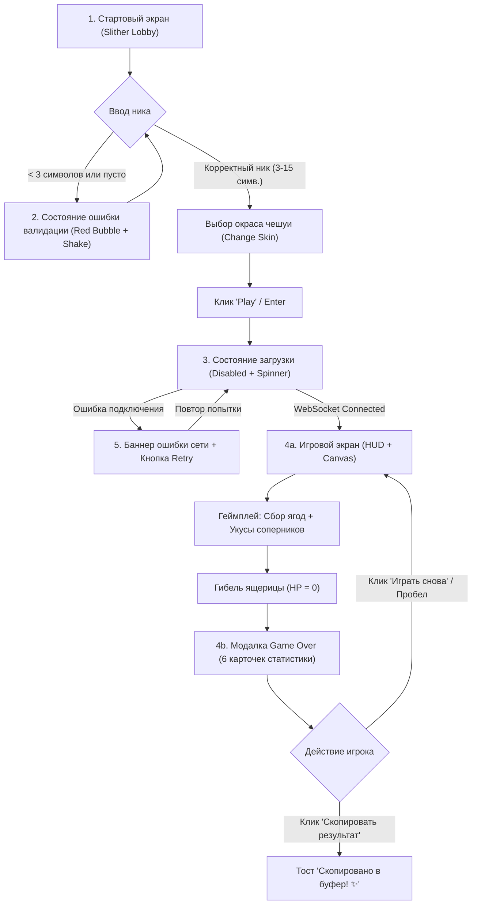

# Спецификация интерфейса: Lizard.io (SDD)

> **Проект:** Lizard.io (многопользовательская браузерная веб-игра в аутентичном стиле Slither.io / Agar.io)  
> **Практика:** 8. Добавляем фронтенд к своему проекту с помощью AI  
> **Методология:** Spec-Driven Development (SDD) & Design System First  
> **Референс:** Slither.io Authentic Neon-Slate & 3D Bubbly Theme ([slither_reference.png](file:///home/mak/aifirst/ITMOv2/practices/practice_08/docs/slither_reference.png))  
> **Figma Design File (AI Prototype):** [Figma File (Lizard)](https://www.figma.com/design/ywphkTEKH5YQzMghdyQCVu/Lizard) | [Векторный экспорт](file:///home/mak/aifirst/ITMOv2/practices/practice_08/docs/figma_design.svg)  
> **Интерактивный прототип (5 состояний):** [prototype.html](file:///home/mak/aifirst/ITMOv2/practices/practice_08/prototype.html)

---

## 1. Контекст проекта и визуальный референс

### 1.1. Описание продукта
**Lizard.io** — браузерная аркада на Canvas, WebSocket и Express, в точности воссоздающая визуальный стиль и пользовательский опыт классического **Slither.io**:
* Полное отсутствие громоздких серых карточек-контейнеров на главном экране: логотип, поле ввода и кнопка свободно парят по центру глубокого темного фона `#161c22`.
* **Объёмный 3D-шрифт логотипа (`lizard.io`)**: круглый жирный шрифт (`Fredoka 900`) с градиентным затемнением сверху вниз:
  * `lizard.` — градиент от кислотно-зелёного (`#5dfc7c`) к глубокому изумрудному (`#0f752d`) с тёмно-зелёным 3D-скосом (`#0d5424`) и глубокой падающей тенью `0 12px 24px rgba(0,0,0,0.9)`.
  * `io` — градиент от ярко-фиолетового (`#c77bff`) к насыщенному пурпурному (`#4b0e9e`) с глубоким фиолетовым 3D-скосом (`#3b0e77`).
* **Поле ввода никнейма**: вытянутый закруглённый pill-shape инпут пыльно-фиолетового цвета (`#464265`) с выраженной внутренней тенью (`inset 0 3px 6px rgba(0,0,0,0.55)`).
* **Глянцевая кнопка «Play»**: компактная овальная кнопка с зелёным градиентом сверху вниз (`#4de084` ➔ `#13833d`) и физическим 3D-скосом снизу (`box-shadow: 0 4px 0 #105c28`).
* **Угловые виджеты**: «Change Skin» (слева снизу), «Choose Server» (справа снизу) и «Graphics: High quality» (справа сверху).

---

## 2. Основной пользовательский сценарий (Core Flow)



---

## 3. Требования к 5 ключевым состояниям интерфейса

### Состояние 1: Исходный экран (Default / Lobby)
* Логотип `lizard.io` (зеленый `lizard.`, фиолетовый `io`, объёмный 3D-шрифт, затемнение сверху вниз).
* Подзаголовок: `Eat berries to grow longer!` фиолетового цвета `#7b6a98`.
* Поле ввода никнейма: закруглённый pill-shape инпут пыльно-фиолетового цвета (`#464265`).
* Кнопка запуска: зелёный глянцевый овал `Play` с 3D-эффектом нажатия.
* Селектор окрасов: 7 контрастных скинов в плавающей капсуле над кнопкой «Change Skin».
* Виджеты по углам экрана: «Change Skin», «Choose Server», «Graphics: High quality».

### Состояние 2: Ошибка валидации (Validation Error)
* При пустом вводе или имени `< 3` символов под полем ввода появляется всплывающий блок ошибки `#nickname-error` с текстом: `⚠️ Имя должно содержать от 3 до 15 символов`.
* Инпут получает красное свечение `box-shadow: 0 0 16px rgba(239, 68, 68, 0.7)`.
* Центральный блок совершает микро-анимацию потряхивания (`.shake`).
* Повторная отправка блокируется до ввода корректного значения.

### Состояние 3: Загрузка и защита от спама (Loading / Anti-Spam Lockout)
* При клике кнопка `Play` мгновенно блокируется: `disabled="true"`, `aria-busy="true"`.
* Текст кнопки заменяется на спиннер и статус `Подключение к арене...`.
* Повторные быстрые клики (Double-Click) и нажатия Enter игнорируются; на сервер уходит ровно 1 запрос `join`.

### Состояние 4: Игровой HUD и Результат матча (HUD & Game Over Modal)
* **HUD:** В верхнем левом углу отображается имя игрока, полоса HP (100–1000+), счётчики ягод и укусов; в правом верхнем углу — живой лидерборд; в правом нижнем углу — миникарта.
* **Game Over Modal:** Тёмная стеклянная карточка с черепом `💀`, именем победителя (`#killer-name-display`) и 6 плитками метрик (финальный счёт, время выживания, ягоды, урон, фраги, максимальный размер). Кнопка «Играть снова» мгновенно респавнит игрока, а «Скопировать результат» сохраняет отчёт в буфер обмена с всплывающим тостом.

### Состояние 5: Ошибка соединения (Connection Error & Retry)
* При недоступности сервера или обрыве связи WebSocket над логотипом отображается стильный алерт-баннер `#connection-alert` (`role="alert"`).
* Содержит понятный текст: `⚠️ Ошибка соединения: Сервер недоступен` и кнопку `[Повторить]` (`#retry-conn-btn`), восстанавливающую связь.
* Кнопка `Play` блокируется со статусом `Сервер недоступен`.

---

## 4. Дизайн-система (Slither-Lizard UI)

```css
:root {
  /* Slither.io Background & Canvas */
  --bg-canvas: #161c22;
  --bg-card: rgba(22, 28, 38, 0.96);

  /* Slither Dusty Purple Input */
  --input-bg: #464265;
  --input-text: #ffffff;
  --input-placeholder: #8c82ab;
  --subtitle-color: #7b6a98;

  /* Slither 3D Green (Top-to-Bottom Shading) */
  --slither-green-top: #5dfc7c;
  --slither-green-mid: #2ecc71;
  --slither-green-bot: #13833d;
  --slither-green-bevel: #0d5424;

  /* Slither 3D Purple (Top-to-Bottom Shading) */
  --slither-purple-top: #c77bff;
  --slither-purple-mid: #9e4bf9;
  --slither-purple-bot: #5b13b8;
  --slither-purple-bevel: #3b0e77;

  /* Typography */
  --font-display: 'Fredoka', cursive, sans-serif;
  --font-sans: 'Outfit', -apple-system, sans-serif;
}
```

---

## 5. Доступность (A11y)

* Ярлык для скринридеров: `<label for="nickname-input" class="sr-only">Имя твоей ящерицы:</label>`.
* Доступный селектор скинов: `role="radiogroup"`, `tabindex="0"`, `role="radio"`, `aria-checked="true"`.
* Видимый индикатор фокуса: `:focus-visible { outline: 2px solid var(--ring); outline-offset: 3px; }`.
* Полное управление с клавиатуры: `Tab`, `Стрелки`, `Enter`, `Space`.
